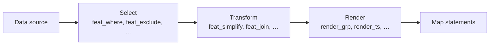

# Writing map templates

mapbuilder generates map files for the EuroScope plugins **Ground Radar (GRP)** and **TopSky** from
templates. A template is a `.jinja` file in your `maps/` directory. It mixes plain map statements
(`MAP:`, `COLOR:`, …) with [Jinja](https://jinja.palletsprojects.com/) expressions that draw
geometries from your data sources.

This section describes the **Feature API (v2.1)**: a set of Jinja filters that work on
*features* (a geometry plus its properties) and turn them into map statements.

## A first template

```jinja title="maps/grplugin/100-EDDM/107-taxilanes.jinja"
MAP:Taxilanes
AIRPORT:EDDM
FOLDER:Airport Layout
COLOR:taxilane-yellow


{{ taxilanes['C1'] | feat_join | feat_simplify(0.000005) | render_line('C1') }}
{{ taxilanes['C2'] | feat_join | feat_simplify(0.000005) | render_line('C2') }}
```

Line by line:

1. The map header is copied unchanged into the output.
2. `data.eddm` is a [data source](data.md) defined in `mapbuilder.toml`. `group(...)` collects all
   guidance lines by their designator.
3. Each `{{ … }}` expression is a **pipeline**: it takes the guidance lines of a taxilane, joins
   them into one line, simplifies it and renders it as GRP `LINE` statements.

The output looks like this:

```text
// C1
LINE:48.3501234:11.7712345:48.3502345:11.7723456
LINE:48.3502345:11.7723456:48.3503456:11.7734567
```

## How pipelines work

Every pipeline has the same shape:



- **Selecting and transforming** filters start with `feat_`. They take features and always return
  features, so you can chain them in any order and the properties stay available until the end.
  See [Selecting and transforming](filters.md).
- **Rendering** filters start with `render_`. They end the pipeline and produce the text that goes
  into the map file. See [Rendering](rendering.md).

!!! tip "Features in, features out"

    You never have to think about whether you are holding a feature or a bare geometry. Filters
    accept a single feature, a list of features, a dict of features (as returned by `group(...)` or a
    KML folder) and even bare geometries, and they flatten nested lists and dicts for you.

## Rendering for GRP or TopSky

The quickest way to draw something is `render_grp` or `render_ts`. They render every geometry by its
type, so a folder that mixes areas, lines and points needs only one call:

=== "Ground Radar"

    ```jinja
    COLOR:holdingpoint
    {{ data.eddn_kml['EDDN']['HP CAT 1'] | render_grp }}
    ```

=== "TopSky"

    ```jinja
    COLOR:River
    {{ data.rivers | feat_simplify(0.000005) | render_ts(fill=100) }}
    ```

Use the specific renderers (`render_area`, `render_line`, `render_coordpoly`, …) when you need a
particular statement type. The [rendering reference](rendering.md) lists all of them.

## Jinja tips

- `{{- … }}` and `` strip the whitespace before the tag; mapbuilder also removes leading
  indentation and collapses blank lines in the final file, so you can indent templates freely.
- Keep repeated values in variables: `` and then
  `feat_simplify(default)`.
- Loops work as usual:

    ```jinja
    
        {{- lines | feat_join | render_line(name) }}
    
    ```

- If you mistype a key, for example `taxilanes['C 1']`, mapbuilder logs a warning such as
  `Feature filter got an undefined value: 'dict object' has no attribute 'C 1'` and renders nothing
  for that expression.

## Next steps

- [Data and features](data.md): which data sources produce features and how to access them.
- [Selecting and transforming](filters.md): reference for all `feat_` filters.
- [Rendering](rendering.md): reference for all `render_` filters and output settings.
- [Migrating templates](migration.md): moving existing templates to the Feature API.
