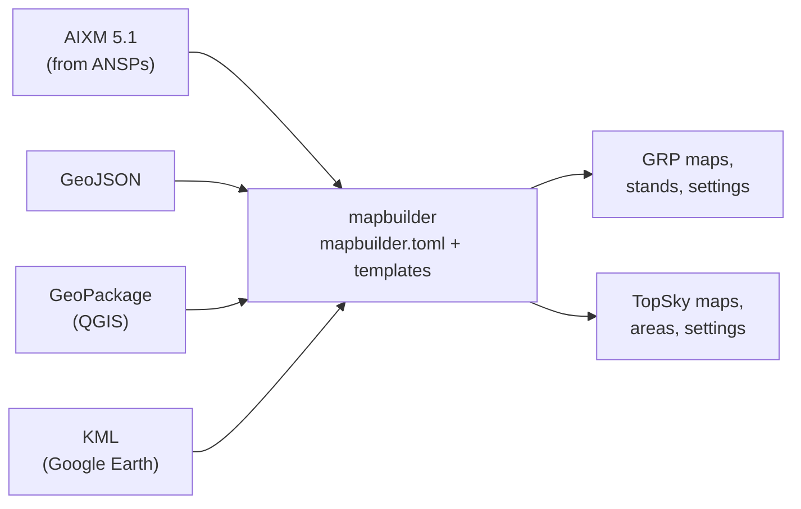

# mapbuilder

**mapbuilder generates map files for the EuroScope plugins Ground Radar (GRP) and TopSky (TS) from
aeronautical data.**

Instead of maintaining thousands of coordinates by hand, you describe *what* to draw in templates.
mapbuilder takes the geometry from various sources and writes the finished
`GRpluginMaps.txt`, `TopSkyMaps.txt`, stand definitions and settings files for every display profile.
When the data changes with the next AIRAC cycle, you rebuild instead of redrawing.

## How it works



1. **Data sources** in `mapbuilder.toml` load your data: AIXM 5.1 AerodromeMapping datasets, GeoPackage layers, etc.
2. **Templates** in the `maps/` directory describe the maps: plain GRP or TopSky statements, plus Jinja
   expressions that select, prepare and draw features from the data.
3. **Profiles** decide which maps go into which files, for example separate day and night setups that
   share most of their content.

## A small example

=== "mapbuilder.toml"

    ```toml
    [data.eddm]
    type = "aixm51"
    source = "dfs:0:EDDM AerodromeMapping:AIXM 5.1.1"

    [profiles.TWR]
    maps = [{ map = "grplugin", target = "GRPlugin/GRpluginMaps.txt" }]
    aliases = []

    [runways]
    ```

=== "maps/grplugin/taxilanes.jinja"

    ```jinja
    MAP:Taxilanes
    AIRPORT:EDDM
    FOLDER:Airport Layout
    COLOR:taxilane-yellow
    
        {{- line | feat_simplify(0.000005) | render_line(line.properties.designator) }}
    
    ```

=== "GRpluginMaps.txt"

    ```text
    MAP:Taxilanes
    AIRPORT:EDDM
    FOLDER:Airport Layout
    COLOR:taxilane-yellow
    // A1
    LINE:48.3561234:11.7712345:48.3562345:11.7723456
    LINE:48.3562345:11.7723456:48.3563456:11.7734567
    // A2
    …
    ```

One template draws every taxilane of the airport, each labelled with its designator, and stays correct
when taxiways are added or renamed in the data.

## Features

- **Official data:** reads AIXM 5.1 AerodromeMapping data provided by many ANSPs.
- **Your own data:** GeoPackage layers and KML files for everything that is not in AIXM, like stand
  areas, construction sites or local markings.
- **One API for both plugins:** filters that select, join and simplify features, and renderers for GRP
  and TopSky, including automatic rendering by geometry type.
- **Profiles:** build several display setups from the same sources, with per-profile variants where
  they differ.
- **Ready for CI:** a GitHub Action that rebuilds the maps of a repository, with caching of downloads.

## Where to go next

<div class="grid cards" markdown>

-   :lucide-download: **Setup**

    ---

    Install mapbuilder, run it and configure your project in `mapbuilder.toml`.

    [:octicons-arrow-right-24: Installation and usage](setup/index.md)

-   :lucide-pen-line: **Writing map templates**

    ---

    Learn how templates select data and draw it as GRP and TopSky maps.

    [:octicons-arrow-right-24: Authoring](authoring/index.md)

-   :lucide-book-open: **Reference**

    ---

    All filters and renderers with their options and output.

    [:octicons-arrow-right-24: Rendering](authoring/rendering.md)

-   :lucide-arrow-right-left: **Migrating**

    ---

    Move existing templates to the Feature API.

    [:octicons-arrow-right-24: Migrating templates](authoring/migration.md)

</div>
